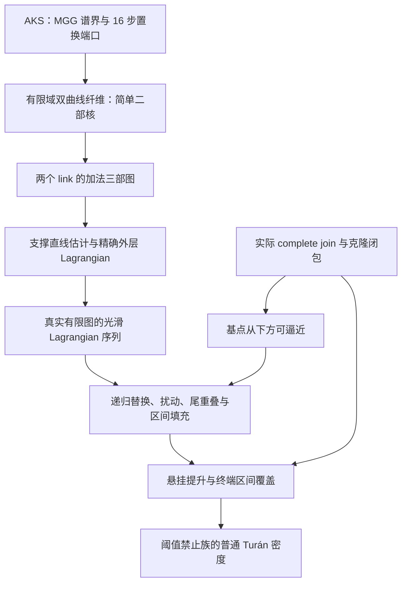

# 主定理依赖与已完成的替代论证

更新：2026-11-26。当前已编译的最终入口是

```lean
IntervalsTuran.main_theorem : IntervalsTuran.MainTheoremStatement
```

它没有谱图族存在性参数。图中的各项是实际证明项及实际有限图构造，不含待补的数学输入。最终验收已通过：104 个模块重新编译，3,296 个声明通过传递公理审计，独立目标类型及源码一致性检查通过。完整记录见 `verification/result.json`。



## 已闭合的主要接口

| 层次 | 关键声明或模块 | 输入如何实际提供 |
| --- | --- | --- |
| 初始谱界 | `spectralGap_mgg` | 从 `girving/aks` 固定提交移植完整依赖闭包并重新编译，声明为 `∀ n, 3≤n → spectralGap (mgg n) ≤ 5*sqrt 2/8`。 |
| 置换端口及功率 | `Spectral.MGG.portPerm`、`sum_square_le` | 每个端口是真正的顶点置换；四次平方给出 q=2⁴⁸ 个端口和非归一化算子界 q/6。 |
| 简单图与左右正则性 | `FiberDesingularization`、`PermutationLift` | 位移 `(a,i/a)` 的标签恢复给出无重边；有限域差分计数恒等式和正交分解给出谱界。 |
| 光滑阶数 | `SimpleExpander.order_ratio_tendsto` | 直接使用 Nⱼ=(j+3)²q²，避免素数分布的额外输入。 |
| 单侧零和谱界 | `SimpleExpander.kernel_hasZeroSumBound_real` | 实际双邻接算子右侧→左侧的界 θ=d/6；不把二部图整个邻接矩阵的 −d 特征值忽略。 |
| 三部估计 | `AdditiveTripartite`、`AdditiveGadgetScaling` | `B(x+y,z)` 定义实际简单三图；两个 link 产生系数 3θ/2。 |
| 外层优化 | `WeakOuterOptimization`、`WeakOuterGraph` | k=d/5，m≥48k，证明所有权重的支撑直线上界并以均匀权重取等。 |
| 图序列 | `SimpleExpander.outerSequence_lagrangian`、`exists_smooth_finite_lagrangians` | λ(Qⱼ)=1−1/k²+((k/3+3)/k²)/(3Nⱼ)，图及全部序列性质均已构造。 |
| 递归基点 | `belowLagrangianApprox_weakOuterBase`、`weakOuterBase_lt_cliqueRatioValue` | complete join 的零输入给出从下方逼近；实际完全三图均匀值给出严格比值间隙。 |
| 非退化区间 | `exists_three_below_lagrangian_interval` | 将实际有限图序列输入已证明的替换、紧致最大化、尾重叠及贪心实现链，所有前提在内部关闭。 |
| 任意 r≥3 的普通密度区间 | `main_theorem`、`ordinary_density_terminal_interval` | 真实悬挂与 complete join 闭包，以及禁止族 `{F : λ(F)>x}` 的普通密度实现。 |

`MainTheoremStatement` 仍表示原论文的普通 Turán 密度结论。不是先假设某个递归值可实现，也不是把需要构造的图族藏在类型类实例中。

## 与原论文路线的关系

原论文使用的特定 Cayley/LPS 谱图输入，在当前最终证明中由 MGG 多重图、简单二部提升及适配后的三部构造替代。外层渐近分析改为精确 Lagrangian 公式；相邻误差比恰等于显式图阶数比。一般最大值扰动及子列工具仍保留，但外层精确公式省去了该处渐近优化和递减子列提取。

下游递归论证仍证明实际有限替换的最大值公式、最小不动点、侧枝扰动的右斜率、尾区间重叠与有限贪心逼近；最终使用真正的普通密度实现、悬挂提升和 complete join 极限。

## 历史条件分支：保留，但不再是主定理的前提

早期入口仍为

```lean
Nonempty Spectral.SmoothSpectralFamily → MainTheoremStatement
```

它要求 138 度有限 Cayley 图族、零和邻接范数至多 47/2 及平滑阶数；该结构仍无实例。它给出的固定参数结果 `899/900 + 1/(540|G|)` 仍是正确的条件推论。**这条旧分支没有被补成 LPS 定理；最终 `main_theorem` 采用另一条已闭合路线。**

旧审计保存在 `docs/proof-review.md` 的历史部分和 `docs/spectral-input-status.md`。新检索与移植证据见 `docs/search-update-2026-11-26.md`、`docs/aks-import.json`。有限图和密度基础的既有来源见 `docs/reused-foundation.json`、`docs/reused-analysis.json`。
